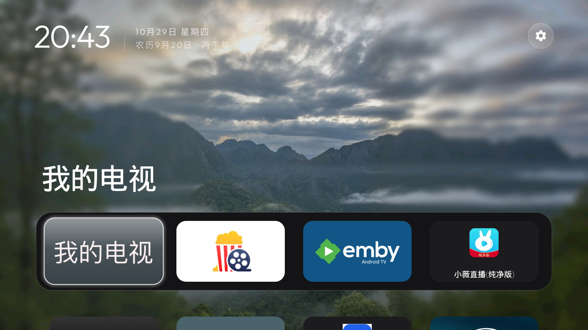
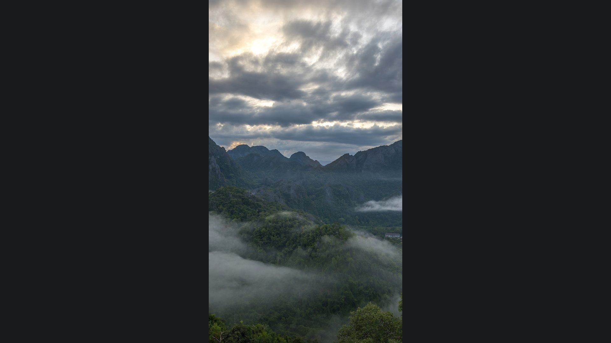
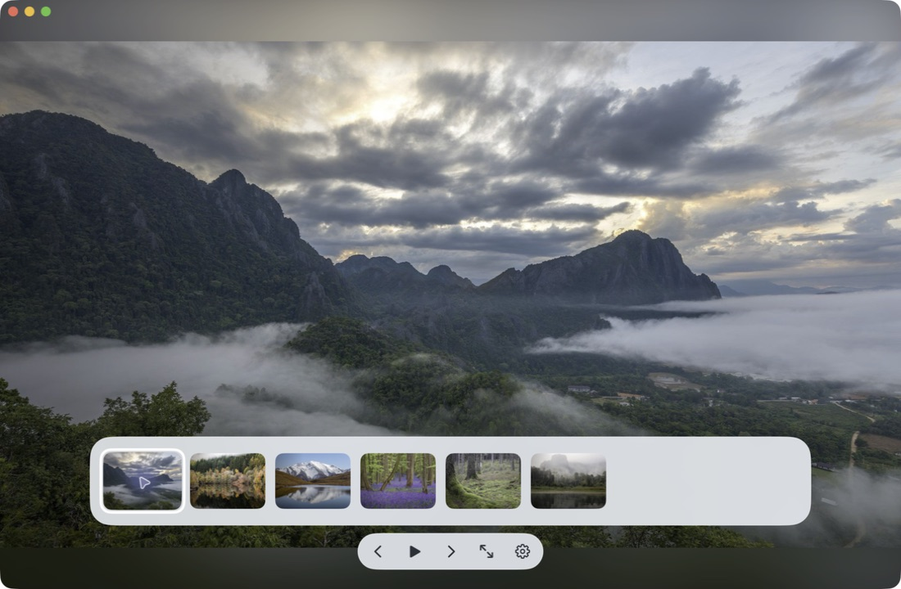
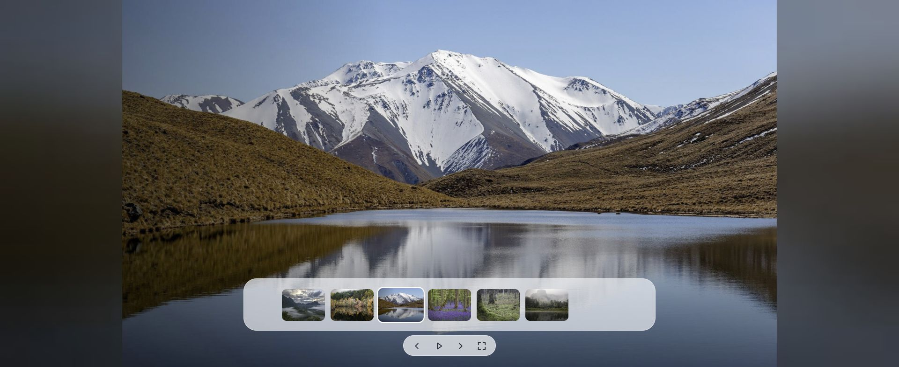

# 让电视回到自己的家

**一个属于自己、更适合家庭的电视桌面。**

打开电视，看到家人的照片、清楚的时间和自己常用的应用。首页的内容由自己决定，留下恰好需要的东西，让电视自然地融入家里的生活。

这个项目从 Android TV 桌面启动器出发，逐步连接家中的 NAS、照片处理服务、Mac 和浏览器。电视桌面是中心，家庭照片把这些设备串在一起：珍藏在硬盘里的回忆，也能成为每天看得见的风景。

*电视桌面真实截图，背景使用本项目本地扩图的风景演示图。*

## 首页，留给自己的生活

简洁的布局，把时间、日期、星期、农历和常用应用放在合适的位置。选择家里真正会用的应用，按自己的习惯安排，让每次打开电视都有熟悉、确定的起点。

家庭照片可以在桌面背景中缓缓轮换。背景功能可以随时开关，也可以使用本地壁纸。

## 电视闲下来，就看看家人

在桌面按返回，或闲置一段时间后，电视可以进入照片相框。照片自动播放，也可以随手前后翻看，在底部缩略图中选中想多看一会儿的那张。

完整的照片配上柔和的同图背景，横图、竖图都能自然呈现。切换平滑过渡，玻璃质感的控制栏在需要时出现，随后安静地隐去。

后面的照片提前加载。网络慢了，就让当前照片多停留一会儿；不会因为下一张还没准备好，就把画面变成黑屏或弹出提示。电视只保留有限的缓存，让播放持续下去。

## NAS，让照片源源不断地来到桌面

照片继续存放在自己的 NAS 上。服务按需随机抽取照片，交给桌面背景、相框和其他客户端，不必先导入整个图库，也不需要为全部照片建立缩略图库。

后台可以提前准备多批电视背景，持续补充新内容。家中网络里的管理页面，可以查看处理进度、已有批次，并展开预览每批照片。服务支持作为 QNAP 应用安装，常驻运行。

从存储到展示，这些工作在家里的设备之间完成。

## 本地扩图，让竖照片也适合大屏幕

手机拍下的许多回忆是竖图。可选的本地 AI 扩图服务，会在 Mac 上提前处理照片，为横向电视画面补充周边环境，再通过柔和处理弱化扩展区域的细节，让原始照片继续成为画面的主角。

一张竖向照片，可以从占据屏幕中央的一小块画面，变成铺满横屏的照片背景：人物和原照片保留在中间，两侧延续照片里的色彩、光线与环境。扩展区域再适度柔化，让画面自然地退到背景里，视线仍然落在真实的家人和回忆上。

相框里的“同图模糊背景”直接使用原照片填充四周；AI 扩图则会生成新的周边内容，适合提前处理后用作桌面背景。两种呈现方式可以分别使用。

| 扩图前：竖幅原图居中展示 | 扩图后：适合电视的横屏背景 |
| --- | --- |
|  |  |

*同一张照片的实际处理对比。演示输入由公开授权的风景照片裁成竖幅，右图使用当前本地工作流生成并柔化两侧。原图之外的景物由 AI 生成，不代表真实拍摄到的场景。[查看竖幅输入](docs/screenshots/outpaint-source.jpg) · [素材来源与处理说明](docs/screenshots/CREDITS.md)。*

NAS 负责挑选和安排任务，Mac 在后台处理，电视拿到已经完成的背景。可以筛选最近十年、包含人物的照片，并检查处理结果，尽量排除新增明显人脸等不适合展示的画面。

成品池可以逐步储备 10 批照片，之后定期补充新批次，再替换旧批次。处理较慢或暂时中断时，电视继续使用已有的可用照片。

扩图可以关闭，原片始终保留。直接看照片的随机相框也可以独立使用，无需为整个图库生成扩图。

## 同一份家庭回忆，也可以放在 Mac 上

独立的原生 Mac 相框，连接同一个 NAS 照片服务。打开应用、移到另一块屏幕、进入全屏，就可以让家人的照片陪在一旁。

它有自己的窗口、播放和缓存，独立于浏览器运行。在主屏工作、开发或操作浏览器时，另一块屏幕上的照片继续播放。支持自动轮播、键盘切换、暂停、玻璃缩略图栏和本地照片恢复。

*原生 Mac 相框实拍界面，使用风景示例照片。*

也提供网页版，在家中浏览器打开即可观看，延续同样简洁的照片播放体验。

*网页版实拍界面。截图中的大图和缩略图均为公开授权的风景素材，[图片来源与授权](docs/screenshots/CREDITS.md)。*

## 围绕一个家庭桌面，连接起来

**NAS 保存与提供照片 → Mac 按需处理背景 → 电视呈现家庭桌面与相框。**

原生 Mac 相框和网页端，也可以直接从 NAS 取照片播放。各个部分按需使用，共同服务于一个简单的愿望：让自己的设备，多呈现一些属于自己家的东西。

目前照片播放以 JPEG 格式为主。照片存储和扩图处理都可以留在本地，无需上传到云端。

---

电视桌面基于 [CleanYourTV](https://github.com/Gathin23/cleanyourtv) 开发，保留原有许可证及第三方声明。
